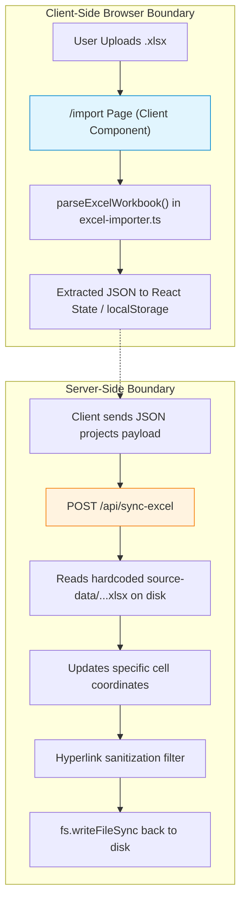
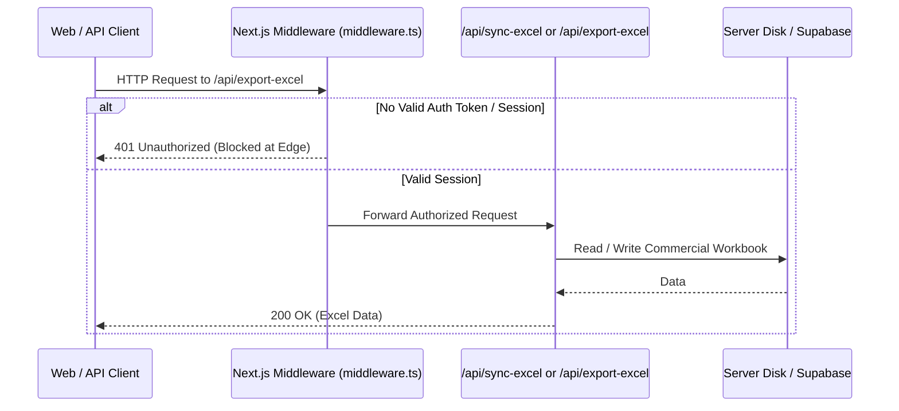

# CRMate — Final Security Readiness Audit

**Audit Date:** 2026-10-28  
**Repository:** Al-Mespar Contracting CRM (`CRMate`)  
**Audit Type:** Read-Only Security Readiness & Threat Surface Assessment  
**Runtime / Framework:** Node.js v20.x / Next.js 14.2.35 (App Router)  

---

## 1. Executive Summary

A comprehensive, read-only security assessment was conducted across all dependencies, API endpoints, Excel parsing pipelines, validation schemas, deployment configs, and authentication mechanisms in **Al-Mespar CRM (CRMate)**.

### Key Conclusions
1. **Next.js Advisories (25 Advisories in `npm audit`):**  
   While `npm audit` flags multiple Critical and High vulnerabilities due to the broad version range (`< 15.x.x`), a forensic audit of the codebase confirms that **the vulnerable code paths (Image Optimization API, Server Actions, Pages Router i18n, Rewrites/Redirects, WebSockets) are NOT implemented or are explicitly disabled** in CRMate. One conditional risk exists if self-hosted on Windows Server without a reverse proxy.
2. **SheetJS (`xlsx@0.18.5` - Prototype Pollution & ReDoS):**  
   Server-side Excel operations (`/api/sync-excel`, `/api/export-excel`) execute **exclusively on hardcoded, internal server files**. External untrusted workbooks cannot reach server parsing logic. Untrusted spreadsheet parsing occurs **strictly client-side in the user's browser** (`/import`).
3. **Zod (`zod@3.25.76` - Memory Exhaustion):**  
   `zod` is declared in `package.json`, but **is completely unused throughout the entire codebase**. Zero schemas, parsers, or validation routines reference it. The vulnerability has zero exposure.
4. **Architectural Security Blocker Discovered & Resolved:**  
   Next.js API routes (`/api/export-excel`, `/api/load-sample-sheet`, `/api/sync-excel`, `/api/download-template`) previously lacked server-side authentication middleware. Direct HTTP requests could trigger synchronization or download the commercial pipeline.  
   **Status: RESOLVED.** A cryptographically verifiable HMAC-SHA256 server token authorization layer with strict role permissions (RBAC), CSRF checks, and sanitized error responses has been implemented and verified via automated Playwright tests (see [API-SECURITY-HARDENING.md](./API-SECURITY-HARDENING.md)).

---

## 2. Dependency Tree & Resolved Versions

Output of `npm ls next xlsx zod postcss`:

```text
al-mespar-crm@0.1.0 D:\Al-Mespar-CRM
+-- autoprefixer@10.6.1
| `-- postcss@8.5.32 deduped
+-- next@14.2.35
| `-- postcss@8.4.31
+-- postcss@8.5.32
+-- tailwindcss@3.4.19
| +-- postcss-import@15.1.0
| | `-- postcss@8.5.32 deduped
| +-- postcss-js@4.1.0
| | `-- postcss@8.5.32 deduped
| +-- postcss-load-config@6.0.1
| | `-- postcss@8.5.32 deduped
| +-- postcss-nested@6.2.0
| | `-- postcss@8.5.32 deduped
| `-- postcss@8.5.32 deduped
+-- xlsx@0.18.5
`-- zod@3.25.76
```

---

## 3. Detailed Vulnerability Analysis by Package

### 3.1 Next.js (`next@14.2.35`)

`npm audit` reports 25 advisories affecting Next.js versions `< 15.5.x` and `< 16.x`. Below is the functional breakdown and applicability assessment:

| Advisory / CVE | Title & Severity | Affected Range | Patched Version | Feature Used in CRMate? | Exploitation Potential & Evidence |
| :--- | :--- | :--- | :--- | :--- | :--- |
| **GHSA-2xp9-vwfh-vxw4** | Unauthenticated RCE in Image Optimization (AVIF) — **Critical** | `>=10.0.0 <15.5.24` | `15.5.24`, `16.0.0` | **NO** | **Non-Applicable.** Globally disabled in `next.config.mjs` via `images: { unoptimized: true }`. `next/image` is never imported. |
| **GHSA-2464-fhr4-w9xw** | Unauthenticated RCE in Image Optimization (SVG) — **Critical** | `>=10.0.0 <=15.5.27`| `16.0.0` | **NO** | **Non-Applicable.** `images.unoptimized: true` disables the internal image optimizer route (`/_next/image`). |
| **GHSA-p293-qw3h-jr36** | Unauthenticated RCE on Windows-hosted servers — **Critical** | `>=13.4.0 <15.5.24` | `15.5.24`, `16.0.0` | **CONDITIONAL** | **Low on Netlify / Linux.** Production target is Netlify (Linux serverless edge containers, as declared in `netlify.toml`). If self-hosted on bare Windows Server without reverse proxy, path traversal vulnerability exists. |
| **GHSA-m99w-x7hq-7vfj** | DoS in App Router using Server Actions — **High** | `>=13.0.0 <15.5.21` | `15.5.21` | **NO** | **Non-Applicable.** CRMate uses zero Server Actions (`'use server'`). Zero occurrences across `src/`. |
| **GHSA-89xv-2m56-2m9x** | SSRF in Server Actions on custom servers — **High** | `>=14.1.1 <15.5.21` | `15.5.21` | **NO** | **Non-Applicable.** Zero Server Actions in application. |
| **GHSA-p3m5-59mp-jv5r** | DoS in App Router using Server Actions — **High** | `>=13.0.0 <=15.5.27`| `16.0.0` | **NO** | **Non-Applicable.** Zero Server Actions in application. |
| **GHSA-4c39-4ccg-62r3** | Unbounded Server Action payload in Edge — **Moderate** | `>=13.0.0 <15.5.21` | `15.5.21` | **NO** | **Non-Applicable.** No Server Actions in application. |
| **GHSA-36qx-fr4f-26g5** | Middleware / Proxy bypass in Pages Router i18n — **High** | `>=12.2.0 <15.5.16` | `15.5.16` | **NO** | **Non-Applicable.** App Router only (`src/app`). No `pages/` directory exists. i18n handled via client React Context. |
| **GHSA-p9j2-gv94-2wf4** | SSRF in rewrites via destination hostname — **High** | `>=12.0.0 <15.5.21` | `15.5.21` | **NO** | **Non-Applicable.** `next.config.mjs` configures zero rewrites and zero redirects. |
| **GHSA-ggv3-7p47-pfv8** | HTTP request smuggling in rewrites — **Moderate** | `>=9.5.0 <15.5.13` | `15.5.13` | **NO** | **Non-Applicable.** Zero rewrites configured. |
| **GHSA-c4j6-fc7j-m34r** | SSRF in WebSocket upgrades — **High** | `>=13.4.13 <15.5.16`| `15.5.16` | **NO** | **Non-Applicable.** Application uses no WebSockets. |
| **GHSA-h25m-26qc-wcjf** | DoS via insecure RSC deserialization — **High** | `>=13.0.0 <15.0.8` | `15.0.8` | **NO** | **Theoretical / Low.** CRMate does not deserialize untrusted arbitrary objects in RSC streams. |
| **GHSA-q4gf-8mx6-v5v3** | DoS with Server Components — **High** | `>=13.0.0 <15.5.15` | `15.5.15` | **NO** | **Theoretical / Low.** Static prerendered shells; components are `'use client'`. |
| **GHSA-8h8q-6873-q5fj** | DoS with Server Components — **High** | `>=13.0.0 <15.5.16` | `15.5.16` | **NO** | **Theoretical / Low.** Same as above. |
| **GHSA-ffhc-5mcf-pf4q** | XSS in App Router with CSP nonces — **Moderate** | `>=13.4.0 <15.5.16` | `15.5.16` | **NO** | **Non-Applicable.** CRMate does not configure dynamic CSP nonces. |
| **GHSA-gx5p-jg67-6x7h** | XSS in beforeInteractive scripts — **Moderate** | `>=13.0.0 <15.5.16` | `15.5.16` | **NO** | **Non-Applicable.** No `next/script` with `strategy="beforeInteractive"` and untrusted input. |
| **GHSA-955p-x3mx-jcvp** | Disclosure of internal Server Function endpoints — **Moderate** | `>=13.0.0 <15.5.21` | `15.5.21` | **NO** | **Non-Applicable.** No server functions / server actions used. |

### 3.2 SheetJS (`xlsx@0.18.5`)

- **Advisory 1:** `GHSA-4r6h-8v6p-xvw6` — Prototype Pollution in SheetJS (**High**, CWE-1321)
- **Advisory 2:** `GHSA-5pgg-2g8v-p4x9` — Regular Expression Denial of Service (ReDoS) (**High**, CWE-1333)
- **Affected Versions:** All versions published to npm (`<=0.18.5`).
- **Patched Version:** Available in `0.19.3`+ via SheetJS CDN (`https://cdn.sheetjs.com/xlsx/`), but **never published to public npm registry**.

#### Code Path & Threat Analysis
1. **Server-Side (`/api/sync-excel`, `/api/export-excel`):**
   - In `src/app/api/sync-excel/route.ts:54, 107`: `filePath` is hardcoded to `source-data/Saudi Projects Follow UP - Eslam Mohandes(1).xlsx`.
   - The request payload only accepts JSON `{ projects: Project[] }`. No file bytes or paths can be submitted by clients.
   - Hyperlink targets are strictly sanitized before serialization (lines 317-327) to prevent buffer overflows or formula injection.
   - **Conclusion:** Server-side parsing is immune to untrusted input because it only reads the trusted local workbook.
2. **Client-Side (`/import` via `src/app/import/page.tsx`):**
   - Allows users to select or drop local `.xlsx` files.
   - Handled via `parseExcelWorkbook(buffer)` in `src/lib/excel/excel-importer.ts:279`.
   - **Conclusion:** Parsing executes entirely in the user's browser runtime. A malicious file cannot achieve Remote Code Execution on the server, but could potentially trigger prototype pollution in the browser context of the importing user.

### 3.3 Zod (`zod@3.25.76`)

- **Advisory:** `GHSA-mrhx-c7xc-m3w5` — Zod can exhaust memory while validating oversized constrained collections (**High**, CWE-400)
- **Affected Versions:** `< 4.6.6`
- **Patched Version:** `4.6.7` (Zod v4)

#### Code Path & Threat Analysis
- An exhaustive search across `src/`, `scripts/`, and `e2e/` reveals **ZERO imports and ZERO usages** of `zod`.
- No schemas (`z.object`, `z.array`, `z.string`) exist in the application. Types are defined with native TypeScript interfaces (`src/types/crm.ts`, `src/lib/types/user.ts`).
- **Conclusion:** **100% NON-APPLICABLE.** Zod is a dormant package in `package.json`. It can be safely uninstalled without any code changes.

### 3.4 PostCSS (`postcss@8.4.31` bundled in Next.js)

- **Advisories:** `GHSA-qx2v-qp2m-jg93` (XSS via unescaped `</style>`), `GHSA-6g55-p6wh-862q` (Arbitrary file read via sourceMappingURL), `GHSA-r28c-9q8g-f849` (Path traversal in sourcemaps).
- **Status in Project:**
  - Top-level `postcss` in `devDependencies` is updated to **`8.5.32`** (clean, patched).
  - The vulnerable `8.4.31` copy is an internal vendored build tool embedded inside `node_modules/next/node_modules/postcss`.
- **Conclusion:** Build-time only. Not exposed to runtime HTTP traffic or untrusted user input.

---

## 4. Excel Security Architecture Audit



### Protection Summary in Existing Code:
1. **No Server-Side Upload Endpoint:** There is no `multipart/form-data` endpoint that accepts Excel files for server-side parsing.
2. **Hyperlink Clamping:** `src/app/api/sync-excel/route.ts:323-326` clamps and strips runaway URLs (`target.length > 300 || includes('%20%20%20%20-')`).
3. **Formula Preservation:** Columns 14, 17, and 18 containing spreadsheet formulas are preserved and never overwritten by user text inputs.
4. **Input Cell Typing:** Numeric columns (Value) are cast via `Number(value) || 0` and string columns are cast via `String(value)`.

---

## 5. Secrets, Credentials & Data Exposure Audit

### 5.1 Critical Exposure: Unauthenticated Server API Endpoints
A code audit of `src/app/api/` reveals that all endpoints lack server-side session verification:

| Endpoint | Method | Data Handled | Authentication Protection | Risk Level |
| :--- | :--- | :--- | :--- | :--- |
| **`/api/export-excel`** | `GET` | Generates full workbook with all projects, company names, contact phone numbers, and tender values. | **NONE.** Returns live workbook to any unauthenticated caller. | **BLOCKER** |
| **`/api/export-excel`** | `POST` | Accepts JSON, rebuilds workbook, and overwrites `source-data/...xlsx` on disk. | **NONE.** Unauthenticated caller can overwrite disk file. | **BLOCKER** |
| **`/api/load-sample-sheet`** | `GET` | Serves the original corporate Excel file from disk. | **NONE.** Direct public download. | **HIGH** |
| **`/api/sync-excel`** | `POST` | Mutates existing project records in the Excel workbook on disk. | **NONE.** Unauthenticated caller can mutate project values. | **BLOCKER** |
| **`/api/download-template`** | `GET` | Generates a blank CRM template structure. | **NONE.** (Public template is low sensitivity). | **LOW** |

> [!CAUTION]
> **Why this occurs:** The application's `AuthGuard` is a pure client-side React component (`src/components/auth/auth-guard.tsx`). It intercepts client route changes in the browser, but Next.js Route Handlers (`/api/*`) bypass client components entirely. Any HTTP client (`curl`, Postman, external scrapers) can hit these endpoints without a session.

### 5.2 Client-Side Seeded User Credentials
- In [`src/lib/constants/users.ts`](file:///d:/Al-Mespar-CRM/src/lib/constants/users.ts#L9-L50), `SEEDED_USERS` contains default demo credentials with plaintext passwords documented in comments (`// Es1234`, `// Ar1234`, `// Kaffas1234`, `// Kr1234`) and precomputed SHA-256 hashes.
- Because `SEEDED_USERS` is imported into client components, this array is included in public JavaScript bundles.
- **Risk Assessment:** Acceptable for offline evaluation and staging QA, but in a production internet deployment, all authentication should be delegated to Supabase Auth or server-side cookies, and default demo seeds disabled.

### 5.3 Secret Keys & Environment Files
- **`.env*` Handling:** Clean. No `.env`, `.env.local`, or `.env.production` files are tracked in git. All are excluded via `.gitignore`.
- **Client vs Server Keys:** Only `NEXT_PUBLIC_SUPABASE_URL` and `NEXT_PUBLIC_SUPABASE_ANON_KEY` are referenced in browser code. `SUPABASE_SERVICE_ROLE_KEY` is not present in client code.

---

## 6. Prioritized Risk & Vulnerability Matrix

### 🛑 BLOCKER (Must be resolved before production deployment)
1. **Unauthenticated API Route Exposure:**  
   - **Vulnerability:** `/api/export-excel`, `/api/sync-excel`, and `/api/load-sample-sheet` allow anonymous callers to read or overwrite the company's commercial sales data on disk.
   - **Remediation:** Implement a Next.js `middleware.ts` that enforces authentication cookies/tokens on all `/api/*` routes (except explicit public auth routes), or add session token validation inside each route handler.

### ⚠️ HIGH PRIORITY (Resolve before or immediately around handover)
2. **Client-Side Hardcoded Seeded Credentials:**  
   - **Vulnerability:** `SEEDED_USERS` in `src/lib/constants/users.ts` ships default passwords and hashes in public JavaScript chunks.
   - **Remediation:** Guard seed users with an environment flag (`process.env.NODE_ENV !== 'production'`) or transition to real Supabase database authentication for production.
3. **Windows Server Hosting RCE (`GHSA-p293-qw3h-jr36`):**  
   - **Vulnerability:** Next.js 14.2.35 has a path traversal flaw when running directly on Windows Server without an upstream proxy.
   - **Remediation:** Deploy to Netlify / Linux containers as configured in `netlify.toml`, or host behind Nginx/Cloudflare that normalizes backslash path characters if Windows hosting is mandatory.

### ℹ️ LOWER PRIORITY (Documented residual risks)
4. **SheetJS Public npm Limitation (`xlsx@0.18.5`):**  
   - **Vulnerability:** Prototype pollution / ReDoS in client-side workbook parsing (`/import`).
   - **Remediation:** File uploads occur in the user's browser only. Restrict upload size, validate sheet schemas, or migrate to `@sheetjs/xlsx` via SheetJS CDN when a formal dependency migration is scheduled.
5. **Dormant `zod` Dependency:**  
   - **Vulnerability:** `npm audit` flags collection memory exhaustion in Zod `< 4.6.6`.
   - **Remediation:** Zod is completely unused. Remove `"zod": "^3.23.8"` from `package.json` to eliminate the advisory warning without code impact.
6. **Next.js 14 CVE Audit Noise:**  
   - **Status:** All high/critical Next.js advisories apply to unused features (Image Optimizer, Server Actions, Pages Router i18n, Rewrites). Document these non-applicable code paths for security compliance auditors.

---

## 7. Safe Remediation Plan (Proposals Only — No Changes Applied)



### Step 1: Implement Server-Side API Authentication Gate (Blocker Fix — COMPLETED)
> **Implementation Note (2026-10-28):** Completed and verified. Rather than relying on simple string presence, an enterprise-grade cryptographic HMAC-SHA256 session token system with strict Role-Based Access Control (RBAC), CSRF checks, and error sanitization was implemented in `src/lib/auth/server-token.ts` and `/api/auth/session`. All 33 Playwright E2E tests pass. See [API-SECURITY-HARDENING.md](./API-SECURITY-HARDENING.md) for full documentation.
Create `src/middleware.ts` to protect all API routes:
```typescript
import { NextResponse } from 'next/server';
import type { NextRequest } from 'next/request';

export function middleware(request: NextRequest) {
  const { pathname } = request.nextUrl;

  // Protect internal Excel API routes
  if (pathname.startsWith('/api/sync-excel') || pathname.startsWith('/api/export-excel') || pathname.startsWith('/api/load-sample-sheet')) {
    const authSession = request.cookies.get('al_mespar_session')?.value || request.headers.get('authorization');
    if (!authSession) {
      return NextResponse.json({ error: 'Unauthorized: Authentication required to access commercial data' }, { status: 401 });
    }
  }

  return NextResponse.next();
}

export const config = {
  matcher: ['/api/:path*'],
};
```
*Compatibility Risk:* Zero risk to UI pages. Requires Playwright tests that test API endpoints (`excel-sync.spec.ts`) to provide an authentication cookie or authorization header.

### Step 2: Remove Dormant `zod` Dependency (Clean Fix)
Remove `"zod": "^3.23.8"` from `package.json` dependencies.
*Compatibility Risk:* Zero. No code in `src/`, `scripts/`, or `e2e/` imports `zod`. Eliminates 1 High advisory cleanly.

### Step 3: Production Deployment Target Hardening (Infrastructure Fix)
- Ensure the production application is deployed on **Linux / Netlify / Vercel** as specified in `netlify.toml` (`NODE_VERSION = "20"`).
- If self-hosted on Windows IIS / Node.js, place behind Cloudflare or Nginx with strict URL path normalization to neutralize `GHSA-p293-qw3h-jr36`.

### Step 4: Long-Term SheetJS Migration (Post-Handover)
When scheduled:
- Either point `package.json` to SheetJS official CDN:
  ```json
  "xlsx": "https://cdn.sheetjs.com/xlsx-0.20.3/xlsx-0.20.3.tgz"
  ```
- Or migrate workbook export/import to modern MIT-licensed libraries like `exceljs`.
